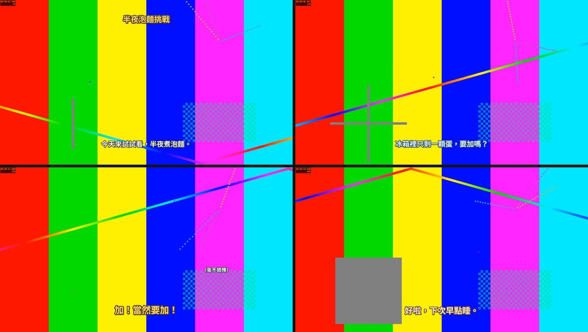
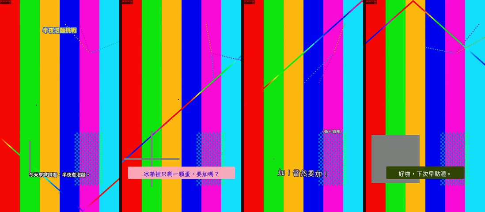

# local-caption-cut

把手機拍的影片（朋友聚會、vlog、口播、Pitch）剪成精華，再燒上有角色感的繁體中文特色字幕。全部在本機用 FFmpeg 和 whisper.cpp 跑，影片不會上傳到任何服務。

*Cut phone footage into a tight edit and burn in styled Traditional Chinese captions, locally with FFmpeg and whisper.cpp. Includes a skill file so Claude Code or Codex can run the whole workflow for you.*

| playful（橫式、綜藝感） | whatsub-inspired（直式、每種語氣一種字型） |
|---|---|
|  |  |

（示範畫面是合成的測試圖和系統語音，可以用 `examples/demo/make_demo.py` 自己生成。）

## 流程

```text
原片 .MOV
  → transcribe   whisper.cpp 逐字稿 + silencedetect 精確有聲段落
  → 寫 project.json：剪點（原片秒數）＋ 字幕（原片秒數、語氣角色）
  → cut          逐格對齊剪接、HDR(HLG) 轉 BT.709 SDR、保留原聲、接點加 8–12ms 淡入淡出防爆音
  → captions     角色樣式、自動換行、缺字檢查、字幕自動對應到剪接後時間軸 → .ass / .srt
  → preview      字幕燒在靜態畫格上，先看排版再算整支
  → render       兩段式 loudnorm（-16 LUFS）＋ 燒字幕 → MP4
  → verify       完整解碼、格數、色彩標記、字幕時間、響度、每段聲音和原片比對 → delivery.json
```

剪點和字幕都寫在原片時間上，剪點改了字幕不用重對；跨過被剪掉段落的字幕會自動拆開。

## 安裝

需要 FFmpeg（含 libass、zimg）、whisper.cpp 和 Python 3.10+。

```bash
brew install ffmpeg-full whisper-cpp
```

```bash
pip install -e .
```

```bash
captioncut fonts fetch
```

whisper 模型預設讀 `~/.cache/whisper-cpp/ggml-large-v3-turbo-q5_0.bin`，可從 [whisper.cpp 模型頁](https://huggingface.co/ggerganov/whisper.cpp) 下載，或用 `WHISPER_MODEL` 指到別的檔案。字型會從 [Google Fonts](https://github.com/google/fonts) 下載到 `~/.local/share/captioncut/fonts`，全部是 SIL Open Font License。

## 用法

```bash
captioncut init ~/Downloads/IMG_1234.MOV --style playful
```

```bash
captioncut transcribe ~/Downloads/IMG_1234-edit --by-pauses
```

讀 `source-transcript.txt` 和 `captioncut sheet` 產生的縮圖，決定要留哪幾段、字幕怎麼寫，填進 `project.json`：

```json
{
  "source": "../IMG_1234.MOV",
  "title": "半夜泡麵挑戰",
  "output": "IMG_1234-字幕版.mp4",
  "style": "playful",
  "cuts": [
    {"start": 0.3, "end": 3.9, "purpose": "開場"},
    {"start": 4.7, "end": 8.2, "purpose": "要不要加蛋"},
    {"start": 9.8, "end": 12.1, "purpose": "當然要加"}
  ],
  "captions": [
    {"start": 0.65, "end": 3.6, "text": "今天來試試看，半夜煮泡麵。", "role": "dialogue"},
    {"start": 5.04, "end": 7.9, "text": "冰箱裡只剩一顆蛋，要加嗎？", "role": "question"},
    {"start": 10.16, "end": 11.8, "text": "加！當然要加！", "role": "joke"}
  ],
  "notes": [{"start": 10.2, "end": 11.8, "text": "（毫不猶豫）", "x": 0.74, "y": 0.62}],
  "titles": [{"clip": 0, "text": "半夜泡麵挑戰", "duration": 2.0}]
}
```

```bash
captioncut cut ~/Downloads/IMG_1234-edit
```

```bash
captioncut captions ~/Downloads/IMG_1234-edit && captioncut preview ~/Downloads/IMG_1234-edit
```

字幕滿意之後：

```bash
captioncut render ~/Downloads/IMG_1234-edit && captioncut verify ~/Downloads/IMG_1234-edit
```

或一次跑完 `captioncut all <project>`。

## 字幕樣式

樣式是 `captioncut/styles/` 裡的 JSON，也可以在 `project.json` 的 `style` 指向自己的檔案，或用 `style_overrides` 改單一角色。

- **playful**：同一套粗黑體，用顏色和大小表現語氣。角色：`dialogue`、`question`、`joke`、`reaction`、`hush`、`positive`、`warm`、`note`、`title`。
- **whatsub-inspired**：思源黑體、霞鶩文楷、粉圓、潤字體、芫荽，部分角色有圓角色塊。角色：`dialogue`、`question`、`warm`、`emphasis`、`punchline`、`note`、`title`。部分配色參考 [WhatSub](https://whatsub.equal2.app/subtitle-style/) 公開樣式牆；本專案與 WhatSub 無關。

角色可設定 `font`、`size`（以短邊 1080px 為準，會依解析度縮放）、`color`、`outline`、`border`、`shadow`、`bg`（圓角底色）、`pop`（彈跳縮放）、`tilt`（傾斜角度）、`fade`。

## 讓 AI 幫你剪

[`SKILL.md`](SKILL.md) 寫好了整個流程（怎麼挑剪點、怎麼寫字幕、要檢查什麼）。把這個資料夾放到 `~/.claude/skills/local-caption-cut`（Claude Code）或 `~/.codex/skills/local-caption-cut`（Codex），丟一支影片說「幫我剪成精華加字幕」就可以了。

## 測試

```bash
python3 -m unittest discover -s tests
```

```bash
python3 examples/demo/make_demo.py && captioncut all examples/demo/build/demo-source-edit
```

`--portrait --hdr` 會生成直式、標成 HLG 的版本，測試轉色和 whatsub-inspired 樣式。

## 授權

MIT。下載的字型各自依 SIL Open Font License 1.1。
